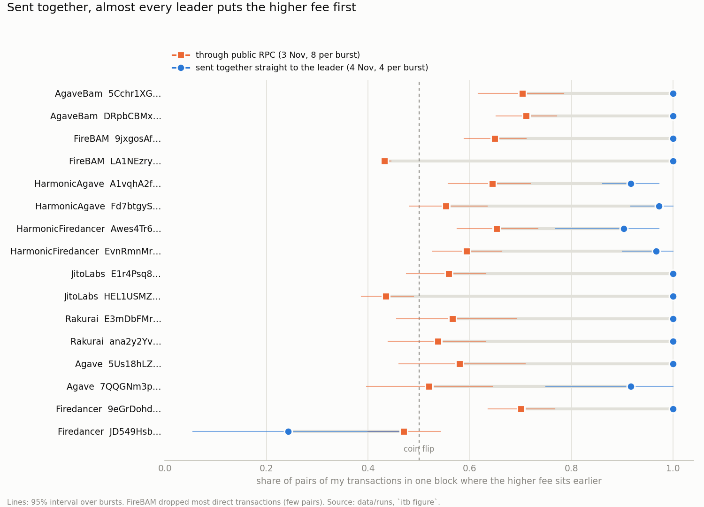

# Inside the Block: how Solana leaders order transactions

I ran every measurement in this repo on 3 and 4 November 2026 from my laptop in Ukraine, paying the fees from my own
wallet [`2Kqf4idi…Hfw8`](https://solscan.io/account/2Kqf4idiM5GJaXbhhcYppZ1cCoRFDsCutS81ntmkHfw8). The question is
the one the bounty asks: for each validator, what decides which of my transactions lands earlier in its block, how
strictly, and is there a rule at all.

The short answer: it depends on whether transactions are waiting at the leader at the same moment. When mine were,
15 of 16 validators put the higher fee first, 90–100% of the time. When they arrived at different moments, which
is what happens through the public RPC, the earlier one usually went first, whatever it paid. The answer for each
validator, and how I got there, is in **[REPORT.md](REPORT.md)**.



Before each follow-up run I pushed my predictions to this repo ([PREREGISTRATION.md](PREREGISTRATION.md)), so you can
check I did not fit them afterwards. 9 of 12 held. The three that failed are in the report, and one of them changed
my main conclusion.

In numbers: 16 validators across 8 clients, 930 bursts and 6 424 transactions, for 0.0499 SOL.

*Коротко українською.* 3 і 4 листопада я надіслав 6 424 власні транзакції у блоки 16 валідаторів mainnet із 8
різними клієнтами й подивився, де саме вони опинилися. Якщо транзакції чекають у лідера одночасно, майже всі
валідатори ставлять першою ту, що платить більше: 15 з 16, у 90–100% випадків. Якщо ж вони приходять у різний час, а
через публічний RPC буває саме так, першою зазвичай іде та, що прийшла раніше. Перед кожним перевірочним прогоном я
викладав прогнози в репозиторій, і справдилися 9 з 12.

## For judges: where each criterion is answered

| criterion | where |
|---|---|
| design (35%) | "Why this design" and "The points the bounty asks about" below; [PREREGISTRATION.md](PREREGISTRATION.md) |
| verifiability (25%) | "Check it yourself in 5 minutes" below; raw signatures and slots in `data/runs/*/landed.jsonl`; `itb verify` |
| analysis (25%) | [REPORT.md](REPORT.md): answer per validator, five steps, 12 predictions with the 3 that failed, what went wrong |
| engineering (15%) | "Spend cap", "Dry-run" and "Run it" below; `itb selftest`; `docker compose up` |

## Check it yourself in 5 minutes

`itb show <run> <burst>` fetches every transaction of one burst from RPC, not from my files. It reads the slot and
position with `getBlock`, the price and memo with `getTransaction`, and the leader from the block's fee reward. Only
the send order comes from my log.

```bash
docker compose run --rm itb show 20261103T193631Z_live 8     # FireBAM: cheap group sent first, no pause
docker compose run --rm itb show 20261103T193631Z_live 53    # HarmonicFiredancer: dear group sent 120 ms later
docker compose run --rm itb show 20261103T155835Z_live 154   # JitoLabs through RPC: random prices
```

What you should see:
1. Burst 8: all 8 transactions in slot 465 019 052, positions 38–66, in strict price order from 3 000 000 down to
   1 000, although the cheap ones were sent first.
2. Burst 53: the cheap group, sent first, at positions 46–151 and in price order inside the group. The dear group sent
   120 ms later comes after it.
3. Burst 154: positions follow the send order 1, 2, 3, 4, 5 while the prices jump around (3 000, 300 000, 3 000 000,
   30 000, 1 000 000).

These are single examples. The numbers that carry the result are in the report. Without my code, one position is one
RPC call:

```bash
curl -s https://api.mainnet-beta.solana.com -H 'Content-Type: application/json' \
  -d '{"jsonrpc":"2.0","id":1,"method":"getBlock","params":[465019052,{"transactionDetails":"signatures","maxSupportedTransactionVersion":1}]}' \
  | python3 -c "import json,sys; print(json.load(sys.stdin)['result']['signatures'].index('3UswzKEUSReacvVyVfzQWxXvQDRdsDqmXqgGGv7aNzecervSLgtYRZWUDphqX3NowknS9S8KisaE8na6vcZK7b7'))"
```

It prints `38`, the position of the 3 000 000 transaction of burst 8.

## Run it

```bash
docker compose up                       # 10-minute dry-run: real schedule and windows, nothing is sent, no key needed
docker compose run --rm itb clients     # who runs which client right now, stake share, where their TPU points
docker compose run --rm itb plan        # which validators would be measured and when their windows come
docker compose run --rm itb selftest    # offline tests: block parsing, windows, probes, spend cap, verdict rules
docker compose run --rm itb analyze     # tables for the main runs
docker compose run --rm itb confirm     # pre-registered tests P1–P6
docker compose run --rm itb paths       # pre-registered tests P7–P8
docker compose run --rm itb firedancer --runs 20261104T200138Z_live   # P9–P10
docker compose run --rm itb indep --runs 20261104T212401Z_live        # P11–P12
docker compose run --rm itb verify      # re-fetch a random sample from RPC and compare positions
```

Real sending needs a key and an explicit flag:

```bash
cp .env.example .env                    # optional: your RPC endpoint (the public one works, slowly)
# put a funded keypair.json (solana-keygen format) into ./secrets/ (git-ignored), or set ITB_SECRET_KEY in .env
docker compose run --rm itb fund --live            # 8 extra fee payers, 0.004 SOL each (parked, not spent)
docker compose run --rm itb run --live --reps 6    # stops at the spend cap (default 0.05 SOL for everything)
docker compose run --rm itb sweep --live           # return the extra payers' SOL to the main wallet
docker compose run --rm itb recollect              # finish collecting if a run was interrupted
```

These are the settings of the runs in `data/`. For the last two, `--validators` takes the 16 identities listed in
`data/runs/20261103T165600Z_live/meta.json`.

```bash
itb run --live --reps 24 --minutes 150 --seed 303                                        # main run 1
itb run --live --reps 24 --minutes 90 --trigger-offset -2 --seed 404                     # main run 2
itb run --live --reps 8 --minutes 90 --series split0,split120 --trigger-offset -2 --seed 505 --validators ...
itb run --live --reps 12 --minutes 120 --burst 4 --series ladder_shared --path alternate --trigger-offset -2 --seed 707 --validators ...
```

Without Docker: `pip install -r requirements.txt`, then `python -m itb <command>`.

## Why this design

I wanted the block itself to tell me which rule the leader followed. So every burst holds transactions that are
identical in everything the scheduler looks at, except two things I control: the fee and the send order. I shuffle
those two independently. A fee rule and an arrival rule then predict different orders for the same burst, and the
block shows which one won. The cleanest cases are the "duels", where the dearer transaction was sent later.

**The probe.** Each transaction is `SetComputeUnitLimit(6000)`, `SetComputeUnitPrice(p)` and a 9-byte memo (`itb` +
burst number + index), so it can also be found by its memo. The memo uses 4 939 compute units; every run checks this
with `simulateTransaction` first. The fee payer is the only writable account. Size, limit and accounts are the same
across a burst, so the leader's cost for each transaction is the same and only `p` changes its priority.

**The series.**

| series | fee payers | prices | what it isolates |
|---|---|---|---|
| `ladder_shared` | one for all | 8 steps, 1 000 to 3 000 000 µlamports/CU | fee among transactions that conflict |
| `ladder_indep` | one each | the same 8 steps | fee among transactions that could run in parallel |
| `equal_indep` | one each | all 100 000 | send order alone |
| `split0`, `split120` | one for all | cheap half sent first, dear half 0 or 120 ms later | whether a short pause changes the order |

Sends within a burst were set 3 ms apart (40 ms in `equal_indep`). On the Windows laptop that ran this, the real gaps
were a median of 4.4 ms and 46 ms. The analysis uses the recorded send order, not the set spacing.

**The verdict.** The unit of evidence is a pair of my transactions that landed in the same block. Pairs in different
slots are not used for order. Pairs from one burst are not independent, so all 95% intervals come from resampling
whole bursts. The rules for calling a verdict are in `itb/analyze.py`. They were committed before the main runs were
analysed (commit `95d35e5`). The follow-up runs had their predictions pushed before they started.

## The points the bounty asks about

**Leader schedule and leader types.** Leaders come from `getLeaderSchedule`. The client comes from the `clientId` each
node announces in gossip, with its version. On 3 November the stake was AgaveBam 37.7%, HarmonicAgave 21.8%, JitoLabs
21.8%, HarmonicFiredancer 8.7%, Firedancer 5.7%, FireBAM 2.0%, Rakurai 1.25% and plain Agave 1.0%. Plain Agave, the
only client whose scheduler is fully public, has about 1% of stake. I took the 2 validators per client with the most
windows left in the epoch. The leader of every block I use is read from the block itself (the fee reward goes to the
leader). A snapshot is saved with every run.

**The path of a transaction.** I used two paths and compared them.
- **Public RPC.** `sendTransaction` to `api.mainnet-beta.solana.com` with `maxRetries=0`, so the RPC sends once and
  never rebroadcasts into a later slot. The public RPC limits sending, so bursts are at least 10 s apart.
- **Direct.** `itb/tpu.py` opens a QUIC connection to the TPU address the leader announces in gossip, as an unstaked
  client. It sends one transaction per stream.

The path turned out to matter most. Through RPC a burst spreads over 1–3 slots; directly it lands in one.

Where the TPU address points is part of the path too. On 3 November every AgaveBam, FireBAM and HarmonicFiredancer
node announced a TPU on a different machine than its own, a shared BAM or Harmonic front end. One of those machines
served 91 validators. JitoLabs, Firedancer, Rakurai and Agave mostly take transactions themselves. `itb clients` prints
this.

**How my transactions interact with each other.** In `ladder_shared` and the split series all transactions share a
fee payer, so they conflict and the leader must run them one after another. In `ladder_indep` and `equal_indep` they
share nothing and could run in parallel. Comparing the two shows whether a leader sorts only conflicting transactions.

**Competition inside the block.** My fees go from 1 000 to 3 000 000 micro-lamports per compute unit. Other
transactions in the same blocks paid a median of about 7 000, a 75th percentile of about 155 000 and a 90th of
about 620 000. So mine are neither the cheapest nor the dearest. Every block I touched is saved whole, so the report
also looks at other people's transactions, but only as side evidence.

**Send order.** Send order is shuffled against the fee in every burst. `equal_indep` takes the fee away entirely. The
split series test send order on purpose, with a pause between two groups.

**Noise against rule.** Each validator got many bursts, there are two validators per client, and the series repeat
the question in different ways. "No rule visible" is an allowed verdict, and the report uses it where the data says
so.

## What this design does not separate

- When the leader received each transaction. I only know when I sent it.
- The leader from the BAM or Harmonic front end in front of it. I measure them together.
- Entry boundaries. `getBlock` gives block order, not entries. Transactions that don't conflict may share an entry.
  That is why the shared-payer series is the cleanest test.
- Staked senders. I used the public RPC and an unstaked direct connection. Paid senders with staked connections were
  not tried. FireBAM dropped most of my direct transactions, which a staked connection would probably avoid.
- Jito bundles and tips, which are out of scope. My transactions never pay tips, and tip-paying transactions are left
  out of the side statistics.

## Spend cap

`--cap-sol` (default 0.05; above that needs `--allow-cap-above`) covers all live runs together. There are two checks,
and either one stops sending:
- The ledger in `data/budget.json` reserves the worst-case fee of each burst before sending. It refuses the burst if
  confirmed fees plus open reservations would go over the cap. Reservations are settled from the real fees in the
  block and stay open until the blockhash expires.
- The sum of all my wallets' balances is checked before every burst against the balance at the first live run.

Moving SOL to the extra fee payers and back is not spend; only the transfer fees count. The whole project spent
0.049861 SOL; the last run was stopped by the cap itself.

## Dry-run

Without `--live` nothing is sent. Everything else happens: the run picks targets from the live schedule, waits for
their windows, builds and signs the transactions, records when it would have sent, and reads the blocks. So you can
see whether the timing hits the window before spending anything.

## Data

```
data/budget.json                    spend ledger
data/landscape/<time>.json          client, stake and TPU snapshots
data/blocks/<slot>.json.gz          every block read, one row per transaction (index, signature, fee, cost, ...)
data/runs/<run>/meta.json           settings, endpoints (no API keys), targets, epoch, payer addresses
data/runs/<run>/sends.jsonl         one row per transaction: burst, series, path, leader, price, send position,
                                    send time (ns), signature, memo
data/runs/<run>/landed.jsonl        one row per transaction: slot, position in block, block leader, fee
data/runs/<run>/events.jsonl        everything the run did, in order
reports/                            generated tables, the figure and the full report
```

All runs were after the Alpenglow upgrade of 21 October 2026. The blocks I read no longer contain vote transactions,
which fits that.

## A note on the commit history

The first 10 commits, from `cf88b91` to `96174dc` (3 November, up to 18:36 UTC), were made before I connected this
repo to my GitHub account. Git on my laptop had a placeholder e-mail in its settings, `nikita@users.noreply.github.com`.
That address belongs to an unrelated GitHub account, so GitHub shows those commits under someone else's name and
picture. The commits are mine, and that person has no access to this repo. I did not rewrite the history to fix it:
the commit hashes and push times are the evidence that the predictions were written before the data, so they stay as
they are. The `claude` co-author on most commits is the AI coding assistant I used.
