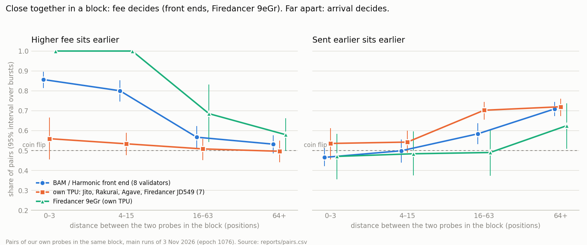

# Report: how 16 mainnet leaders ordered our transactions

All numbers below come from `python -m itb analyze --runs 20261103T155835Z_live,20261103T165600Z_live`. Full tables,
including every validator × series row, are in [reports/summary.md](reports/summary.md). Every pair is in
[reports/pairs.csv](reports/pairs.csv). Each claim can be checked against the chain with the signatures and slots in
`data/runs/*/landed.jsonl`.

## Measurements

All dates are UTC. All runs were in epoch 1076, after the Alpenglow upgrade of 21.10.2026.

| run | when (UTC) | what | bursts | probes |
|---|---|---|---|---|
| `20261103T135933Z_dry` | 2026-11-03 13:59–14:05 | dry-run: timing and block reading, nothing sent | 14 | 112 (not sent) |
| `20261103T152527Z_live` | 2026-11-03 15:25–15:26 | pilot 1, sent through a keyed provider | 17 | 129 |
| `20261103T152855Z_live` | 2026-11-03 15:29–15:33 | pilot 2, public RPC, bursts too close | 25 | 200 |
| `20261103T155835Z_live` | 2026-11-03 15:58–16:53 | **main 1**: send when the first slot of the window is seen | 251 | 2 008 |
| `20261103T165600Z_live` | 2026-11-03 16:56–18:22 | **main 2**: send 2 slots before the window | 303 | 2 424 |
| `20261103T193631Z_live` | 2026-11-03 19:36–20:53 | **confirmation**: pre-registered split series | 122 | 976 |

- Slots 464 957 728 – 464 997 760 for the main runs and 465 018 676 – 465 040 052 for the confirmation run.
- The two pilots are kept in `data/` but left out of the results (see "What went wrong").
- Total spend for everything, pilots, confirmation and transfers included, from the wallet balances:
  **0.043181 SOL**. The main wallet went from 198 800 000 to 155 618 907 lamports, and all sub-wallets were swept back
  to 0.
- The ledger (`data/budget.json`) recorded 0.043082 SOL. The gap of 0.000099 SOL was traced on chain (see "What went
  wrong", items 6 and 7): 0.000067 is one burst fired late after a network drop, and 0.000044 is 4 probes sent while a
  pilot was being stopped. About 0.00001 SOL is left untraced. The cap was never close: 0.05 SOL.
- `itb verify` re-fetched 60 random probes from RPC: 60 of 60 matched in slot, index and block leader.

## Validators

The 16 validators are 2 per client, for 8 clients. For each client the run picked the two with the most leader
windows left in the epoch. The client and version are the ones each node announced in gossip at run start.

| client | validator | version | stake (SOL) | TPU announced on |
|---|---|---|---|---|
| AgaveBam | `DRpbCBMxVnDK7maPM5tGv6MvB3v1sRMC86PZ8okm21hy` | 4.4.0 | 13.0 M | another host (front end) |
| AgaveBam | `5Cchr1XGEg7dbBXByV5NY2ad8jfxAM7HA3x8D56rq9Ux` | 4.4.0 | 5.7 M | another host |
| FireBAM | `9jxgosAfHgHzwnxsHw4RAZYaLVokMbnYtmiZBreynGFP` | 26.10.5 | 4.5 M | another host |
| FireBAM | `LA1NEzryoih6CQW3gwQqJQffK2mKgnXcjSQZSRpM3wc` | 26.10.5 | 0.4 M | another host |
| HarmonicAgave | `Fd7btgySsrjuo25CJCj7oE7VPMyezDhnx7pZkj2v69Nk` | 4.4.0 | 17.0 M | another host |
| HarmonicAgave | `A1vqhA2fS6K7CvHsJKX1ACcHJFEmyRg4KuR5pctHANy4` | 4.3.2 | 3.9 M | another host |
| HarmonicFiredancer | `EvnRmnMrd69kFdbLMxWkTn1icZ7DCceRhvmb2SJXqDo4` | 26.10.5 | 7.8 M | another host |
| HarmonicFiredancer | `Awes4Tr6TX8JDzEhCZY2QVNimT6iD1zWHzf1vNyGvpLM` | 26.10.5 | 7.0 M | another host |
| JitoLabs | `HEL1USMZKAL2odpNBj2oCjffnFGaYwmbGmyewGv1e2TU` | 4.4.0 | 16.7 M | own host |
| JitoLabs | `E1r4Psq84tHfQ6aPTvvDka4U3u8zPVD7gEUrH25RdxHL` | 4.4.0 | 10.4 M | own host |
| Firedancer | `9eGrDohdNTAo61DRHyfMuqKWXqYnA3i254Wiszxe8FoY` | 26.10.5 | 7.0 M | own host |
| Firedancer | `JD549HsbJHeEKKUrKgg4Fj2iyv2RGjsV7NTZjZUrHybB` | 26.10.5 | 6.2 M | own host |
| Rakurai | `ana2y2YvQ3ZPMwm6qhnN3nJoUSiT3qx5Pvetkq9xcfY` | 4.4.0 | 2.5 M | own host |
| Rakurai | `E3mDbFMr8yZcCAZx5wPUFCRmLX31u8Nnj4jPoPc54h3F` | 4.4.0 | 0.9 M | own host |
| Agave | `7QQGNm3ptwinipDCyaCF7jY5katgmFUu1ieP2f7nwLpE` | 4.3.2 | 1.9 M | own host |
| Agave | `5Us18hLZPXJTS4QVuGSsUw137Dyd2tgBaem24Xsf5nBS` | 4.3.2 | 1.2 M | own host |

FireBAM `LA1N…` had only 3 windows during the runs. Its rows are reported but too small to read anything from.

## Short answer

**No validator ordered our transactions strictly by fee across the whole block. Two things decide the order:**

1. **when a transaction reached the leader;**
2. **for transactions that reached it close together, the fee, on some validators.**

*Exploratory view of the main runs: the split by distance was chosen after looking at the data. The confirmation runs
(below) test it with timing we control, against predictions written in advance.*

The split runs along the path more than along the client name:

- **Validators that take transactions through a front end.** These are the BAM and Harmonic groups (AgaveBam,
  FireBAM, HarmonicAgave, HarmonicFiredancer), 8 validators.
  - Our probes that sit close together in the block (≤15 positions apart) are ordered by fee: 0.74–0.95 of pairs.
    Send order does not matter for them: 0.45–0.52.
  - Probes far apart in the block are ordered by arrival: 0.66–0.69 of pairs earlier-sent first. Fee does not matter
    for them: 0.51–0.59.
  - Reading: transactions are taken in batches in arrival order, and sorted by fee inside a batch.
- **Validators that take transactions on their own TPU** (JitoLabs, Rakurai, Agave, and Firedancer `JD549…`), 7
  validators. Fee had no visible effect anywhere in the block: fee_first 0.43–0.58. Arrival order decided, including
  in the duels where the cheaper probe was sent first.
- **The exception is Firedancer `9eGr…`.** It also takes transactions on its own TPU, but sorted close probes by fee
  in every case: 1.00, 116 of 116 pairs. Its neighbour `JD549…` runs the same client and version, from an address one
  digit apart, and showed no fee effect at all. So for Firedancer, the client name alone does not predict the rule.
- **None of the rules is strict across a block.** The strongest one is "fee inside a batch" on AgaveBam, FireBAM and
  Firedancer `9eGr…`, at 0.91–1.00.

## Per validator

Shares with 95% bootstrap intervals over bursts. These are pooled over the two main runs and all three series.

- **fee_first:** among pairs with different prices, the share where the higher price sits earlier.
- **sent_first:** among all pairs, the share where the earlier-sent probe sits earlier.
- **duel:** pairs where the higher price was sent later; the share where fee won.
- **near:** pairs at most 15 positions apart in the block.

The verdict uses the pre-registered rules (see README).

| client | validator | bursts | fee_first | sent_first | duel | verdict | fee_first, near pairs |
|---|---|---|---|---|---|---|---|
| AgaveBam | `DRpbCBMx` | 37 | 0.71 [0.65, 0.77] | 0.63 [0.57, 0.69] | 0.63 [0.54, 0.71] | fee beats send order | 0.93 [0.86, 0.99] |
| AgaveBam | `5Cchr1XG` | 26 | 0.70 [0.61, 0.79] | 0.59 [0.50, 0.67] | 0.65 [0.52, 0.77] | fee beats send order | 0.91 [0.81, 1.00] |
| FireBAM | `9jxgosAf` | 31 | 0.65 [0.59, 0.71] | 0.64 [0.57, 0.71] | 0.53 [0.42, 0.64] | both matter | 0.95 [0.86, 1.00] |
| FireBAM | `LA1NEzry` | 3 | 0.43 | 0.61 | 0.44 | inconclusive (3 bursts) | 5 pairs |
| HarmonicAgave | `Fd7btgyS` | 43 | 0.55 [0.48, 0.63] | 0.58 [0.51, 0.64] | 0.51 [0.39, 0.64] | send order matters | 0.71 [0.60, 0.80] |
| HarmonicAgave | `A1vqhA2f` | 29 | 0.64 [0.56, 0.72] | 0.68 [0.62, 0.74] | 0.51 [0.40, 0.61] | both matter | 0.78 [0.61, 0.88] |
| HarmonicFiredancer | `EvnRmnMr` | 42 | 0.59 [0.53, 0.67] | 0.62 [0.56, 0.67] | 0.50 [0.41, 0.59] | both matter | 0.78 [0.69, 0.87] |
| HarmonicFiredancer | `Awes4Tr6` | 34 | 0.65 [0.57, 0.73] | 0.62 [0.57, 0.68] | 0.55 [0.44, 0.65] | both matter | 0.76 [0.65, 0.86] |
| Firedancer | `9eGrDohd` | 41 | 0.70 [0.63, 0.76] | 0.57 [0.49, 0.65] | 0.71 [0.60, 0.83] | fee beats send order | **1.00 [1.00, 1.00]** |
| Firedancer | `JD549Hsb` | 46 | 0.47 [0.40, 0.54] | 0.75 [0.70, 0.79] | 0.27 [0.21, 0.35] | send order beats fee | 0.53 [0.43, 0.62] |
| JitoLabs | `HEL1USMZ` | 38 | 0.43 [0.39, 0.49] | 0.64 [0.57, 0.71] | 0.31 [0.24, 0.39] | send order beats fee | 0.49 [0.38, 0.59] |
| JitoLabs | `E1r4Psq8` | 37 | 0.56 [0.48, 0.63] | 0.66 [0.60, 0.73] | 0.40 [0.27, 0.54] | send order matters | 0.62 [0.48, 0.75] |
| Rakurai | `ana2y2Yv` | 16 | 0.54 [0.44, 0.63] | 0.70 [0.61, 0.78] | 0.38 [0.22, 0.56] | send order matters | 0.61 [0.47, 0.71] |
| Rakurai | `E3mDbFMr` | 13 | 0.57 [0.45, 0.69] | 0.55 [0.49, 0.62] | 0.55 [0.39, 0.69] | no rule visible | 0.52 [0.42, 0.62] |
| Agave | `7QQGNm3p` | 15 | 0.52 [0.40, 0.63] | 0.71 [0.65, 0.76] | 0.33 [0.20, 0.48] | send order beats fee | 0.41 [0.29, 0.56] |
| Agave | `5Us18hLZ` | 11 | 0.58 [0.47, 0.71] | 0.69 [0.53, 0.81] | 0.42 [0.26, 0.67] | send order matters | 0.54 [0.32, 0.86] |

How strictly each rule holds is the share itself: 0.5 is a coin flip and 1.0 is never broken. The two strongest
results are fee inside a batch on Firedancer `9eGr…` (116 of 116 near pairs) and arrival order on Firedancer `JD549…`
(0.80 of far pairs, interval 0.76–0.84).

## By client

| client | fee_first, near pairs | sent_first, far pairs | duel, all pairs | verdict, all pairs |
|---|---|---|---|---|
| AgaveBam | 0.92 [0.87, 0.98] | 0.66 [0.59, 0.73] | 0.64 [0.57, 0.71] | fee beats send order |
| FireBAM | 0.95 [0.87, 1.00] | 0.68 [0.60, 0.75] | 0.52 [0.42, 0.63] | both matter |
| HarmonicAgave | 0.74 [0.65, 0.82] | 0.68 [0.63, 0.73] | 0.51 [0.43, 0.59] | both matter |
| HarmonicFiredancer | 0.77 [0.70, 0.84] | 0.69 [0.63, 0.74] | 0.52 [0.45, 0.59] | both matter |
| Firedancer (2 validators that disagree) | 0.77 [0.69, 0.86] | 0.69 [0.63, 0.75] | 0.50 [0.40, 0.60] | both matter |
| JitoLabs | 0.56 [0.47, 0.65] | 0.68 [0.63, 0.74] | 0.36 [0.28, 0.45] | send order beats fee |
| Rakurai | 0.57 [0.48, 0.65] | 0.66 [0.59, 0.73] | 0.44 [0.31, 0.58] | send order matters |
| Agave | 0.45 [0.33, 0.59] | 0.72 [0.65, 0.77] | 0.36 [0.26, 0.50] | send order beats fee |

## The three series

Series pooled over all validators:

| series | fee_first | sent_first |
|---|---|---|
| `ladder_shared` (one payer, conflicting) | 0.61 [0.58, 0.65] | 0.60 [0.57, 0.63] |
| `ladder_indep` (no shared account) | 0.58 [0.54, 0.61] | 0.61 [0.58, 0.64] |
| `equal_indep` (same price, ~46 ms apart) | – | 0.75 [0.72, 0.77] |

- **Conflict versus no conflict.** Overall, sharing the fee payer barely changed the fee effect. The exception is
  HarmonicAgave: with a shared payer, fee beats send order (duel 0.64 [0.52, 0.76]); without one, send order beats
  fee (0.38 [0.29, 0.47]). That fits a scheduler that sorts by fee only among transactions that cannot run in
  parallel.
- **Spacing.** With about 46 ms between sends and equal prices, the earlier-sent probe came first in 0.75 of pairs,
  against about 0.60 with ~4 ms spacing (measured medians; see the README note on the timer). The path from our machine to the leader keeps send order roughly, and keeps it better
  when the sends are further apart.

## Sending before the window (main 1 against main 2)

Main 2 sent 2 slots earlier. That moved landings from slot offsets +2…+5 to mostly +0…+2. On AgaveBam and
HarmonicAgave the fee effect grew:

| client | duel, main 1 | duel, main 2 |
|---|---|---|
| AgaveBam | 0.57 [0.40, 0.72] | 0.66 [0.58, 0.74] |
| HarmonicAgave | 0.42 [0.25, 0.56] | 0.56 [0.47, 0.66] |

This fits the batch reading: probes that arrive before or at the start of the block wait together and get sorted. On
JitoLabs it did not change anything: 0.33 in main 1, 0.39 in main 2. The intervals overlap, so this is a hint, not a
result. Per-run tables: `reports/trigger_0/`, `reports/trigger_minus2/`.

## Landing

- 4 432 probes were sent in the main runs, and 4 414 of them landed in blocks we read.
- 3 244 landed inside the target's window: 1 228 of 2 008 in main 1, 2 016 of 2 424 in main 2. The rest landed in the next leader's slots and are not used for order.
- Typical delay from send to block was 1–3 slots.
- The full table per validator is in `reports/summary.md`.

## Background (other transactions in the same blocks)

- 2 361 blocks of the targets were read.
- The rank correlation between position in block and priority fee per cost unit has a median between −0.09 and +0.04
  for every client. In fewer than 5% of blocks it is below −0.3.
- Seen from the whole block, no client sorts by fee. That matches the batch reading: most of a block is a sequence of
  batches in time.
- This uses other people's transactions, which arrive at unknown times. It is context, not evidence.

## Confirmation run (pre-registered)

The batch reading above came from looking at the data, so we tested it with timing we control.

- **Before the run.** [PREREGISTRATION.md](PREREGISTRATION.md) and the test code (`itb/confirm.py`) were pushed to
  GitHub at 19:36:09 UTC, commit `0a66f92`. The first confirmation probe was sent at 19:36 UTC, after the push.
- **Design.** Each burst is two groups of 4 probes with one fee payer:
  - group A is the cheap half of the ladder, sent first;
  - group B is the dear half, sent after a pause of 0 ms (`split0`) or 120 ms (`split120`).
- **Size.** 122 bursts, 976 probes, 0 failed sends.
- **Landing.** All 976 landed, but only 511 inside the target's window: with the 120 ms pause, group B often reaches
  the next leader.
- **Results.** Output of `python -m itb confirm`; all cells are in
  [reports/confirmation/summary.md](reports/confirmation/summary.md).

| test | prediction | result [95% CI] | holds |
|---|---|---|---|
| P1 | front end: inside a group, the higher price sits earlier | 0.72 [0.66, 0.78], 314 pairs | yes |
| P2 | front end: at 120 ms, the cheap group A (sent first) sits earlier | 0.88 [0.76, 0.96], 74 pairs | yes |
| P3 | front end: the A-earlier share rises from 0 ms to 120 ms | +0.46 [+0.27, +0.64] | yes |
| P4 | own TPU: inside a group, no fee sorting | 0.54 [0.43, 0.63], 218 pairs | yes |
| P5 | own TPU: at 120 ms, group A sits earlier | 0.86 [0.65, 0.99], 50 pairs | yes |
| P6 | Firedancer 9eGr: inside a group, higher price earlier (lower bound > 0.6) | 0.70 [0.42, 0.88], 46 pairs | **no** |

**On the front-end validators the order can be switched with a pause alone.** We sent cheap probes first and dear
ones right after. Sent together (0 ms), the dear group came out ahead: the A-earlier share was 0.41 [0.26, 0.57], and
FireBAM alone was 0.12. With 120 ms between the groups, the cheap group came first: 0.88, and FireBAM alone was 1.00.
Inside each group the fee order held at both gaps (0.70 and 0.75).

**On the own-TPU validators, fee did nothing inside a group**, and at 120 ms arrival won (0.86).

**P6 failed.** Firedancer `9eGr…` put the higher price first in 0.70 of within-group pairs, but the interval is wide
(0.42–0.88) and its lower bound is under the 0.6 we wrote down. The 116-of-116 result from the main runs does not
repeat at that strength here. It may be a smaller effect than the main runs suggested, or it may depend on conditions
we did not hold fixed. We cannot tell which from 46 pairs.

**Not predicted, seen in the cells:** Rakurai put the cheaper probe first inside a group, 0.34 [0.20, 0.44]. We have no
explanation for it and did not test it.

## How confident this is

- The overall verdicts per validator use rules fixed in code (commit `95d35e5`). That commit came after the two pilots
  and about 2 minutes into main 1. Main 1 results had not been analysed at that point.
- The batch reading (fee inside a batch, arrival between batches) was then tested on new data against predictions
  pushed in advance. 5 of 6 held (see "Confirmation run").
- These splits of the main runs were added later, after looking at the data, and are **exploratory**:
  - near/far by distance in the block;
  - first slot against later slots;
  - main 1 against main 2.
- The near/far split conditions on where the probes ended up. The distance itself is an outcome, not something we
  controlled. The split is consistent across all four distance bins we looked at (0–3, 4–15, 16–63, 64+; see
  `reports/rules.csv`). It is still a description of what happened, not a randomized comparison.
- Intervals come from resampling bursts, so repeated pairs from one burst are not counted as independent evidence.
- There are two validators per client. They agree for AgaveBam, Harmonic, JitoLabs and Agave, and disagree for
  Firedancer. Two is not enough to call anything a property of a client.

## What went wrong

1. **The public RPC refused `getBlock` (HTTP 429) during the first dry-run.** Fix: separate pacing for `getBlock`, and
   reads moved to a keyed provider.
2. **Transaction version 1 was missed at first.** Its compute limit and fee sit in `transactionConfig`, not in
   ComputeBudget instructions, so the first parser saw a price of 0 for them. Now the parser reads both, and priority
   is computed from `meta.fee` and `meta.costUnits`, which work for every version.
3. **Pilot 1 (15:25 UTC) sent through the keyed provider's free tier.** It rejected 48 of 129 sends with 429, and the
   rejected ones were mostly the late sends of each burst. That links "landed" to send order, so the pilot is not
   used. Fix: send through the public endpoint.
4. **Pilot 2 (15:29 UTC) hit the public endpoint's limit as well:** 11 of 200 sends got 429. The spacing between bursts
   was measured from preparation time instead of firing time. Fix: spacing measured at firing time, at least 10 s.
   Main 1 then had 2 failed sends in 2 008, and main 2 had 8 in 2 424 (all 8 in one burst, see item 7).
5. **Main 1 landed late.** Sending when slot 0 of the window was seen meant probes arrived 2–5 slots later. For the
   two Agave validators most probes fell into the next leader's slots. Main 2 sends 2 slots earlier.
6. **Pilot 1 and main 1 were stopped by hand.** The probes still in flight were collected afterwards with
   `itb recollect`, which settles the ledger from the chain. One burst of pilot 1 was being fired at the moment it
   was stopped. 4 of its probes reached the chain but were never written to `sends.jsonl`. We found them later from
   the sub-wallets' history (slot 464 948 801, fees 44 024 lamports). They are not used anywhere.
7. **Network drop at about 17:30 UTC during main 2.** The machine running the experiment lost its internet connection
   for about 5 minutes.
   - Burst 170: all 8 sends failed, so nothing was sent.
   - Burst 171 waited for its window, and when the connection came back it fired 1 569 slots late. Its 8 probes
     landed in another leader's block (slots 464 984 591–464 984 592), outside the slots we collect. The ledger
     recorded 0 for them, but they cost 66 664 lamports.
   - The burst is excluded from the analysis because none of its probes have a recorded position.
   - Fix (after the runs): a burst is now abandoned if its trigger slot passed more than 2 slots ago
     (`--max-late-slots`).
8. **Funding.** SOL was first withdrawn from an exchange over the wrong network (BEP-20
   instead of Solana). It did not affect the measurement, only the start time.

## What this does not tell us

- **Arrival time at the leader.** We know when we sent, not when the leader received. All "arrival" findings mean
  "send order through public RPC → leader TPU or front end".
- **Who sorts.** For BAM and Harmonic validators we cannot tell whether the sorting happens in the front end or in
  the leader. The data shows the result of the whole chain.
- **Entries.** Block order is not entry order. Close pairs that do not conflict may sit in one entry.
- **The fee range.** Our prices run from 1 000 to 3 000 000 micro-lamports/CU. A leader could use a threshold outside
  that range.
- **Time.** Everything comes from about 2.5 hours on one day. Client versions and BAM/Harmonic routing change often,
  so a re-run should be dated separately (`itb clients` prints the current state).
