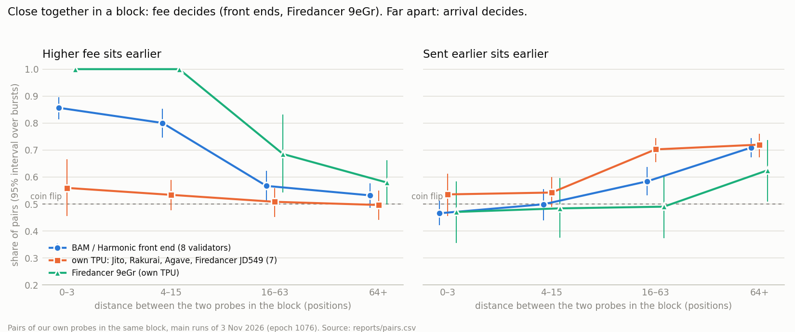

# Full report: how 16 mainnet leaders ordered our transactions

This is the long version with every table. The short version is [REPORT.md](../REPORT.md).

The bounty asks, for each validator: by what rule does it order transactions in its block, how strictly does the rule
hold, and is there a rule at all. The answer is the first table below. The rest of the report is the evidence, from
the strongest test to the weakest.

Every number can be regenerated from `data/` with these commands:

| command | what it produces |
|---|---|
| `itb paths` | direct TPU against RPC |
| `itb confirm` | the pre-registered split runs |
| `itb analyze --runs 20261103T155835Z_live,20261103T165600Z_live` | the main runs |

Every pair of probes is in `reports/*/pairs.csv` or `reports/pairs.csv`. Every claim can be checked against the
chain with the signatures and slots in `data/runs/*/landed.jsonl`.

## Short answer

1. **When our transactions reach the leader together, almost every validator puts the higher fee first.**
   - Sent straight to the leader's TPU just before its block, our conflicting probes landed in fee order 0.90–1.00 of
     the time on 15 of 16 validators: Jito, Rakurai, Agave, BAM, Harmonic and one Firedancer.
   - The exception is Firedancer `JD549…` at 0.24. It put the cheaper probe first.
   - Details are in "Path run" below.
2. **Whether they reach it together depends on time and on the path.**
   - Through the public RPC our probes arrive spread over 1–3 slots, and then arrival order wins. On Jito, Rakurai
     and Agave the fee had no visible effect on that path (0.43–0.58).
   - BAM and Harmonic front ends collect transactions in batches (Harmonic documents 50 ms batches). The fee wins
     inside a batch, arrival wins between batches, and a 120 ms pause between two groups flips the order (confirmation
     run).
3. **Nothing is strict across a whole block.** A block is a sequence of batches in time.

## Answer per validator

Three kinds of evidence go into each row:
- **Together, direct.** In the path run, 4 conflicting probes were sent straight to the leader's TPU just before its
  block, so they reached it together. The column gives the share of pairs where the higher fee sat earlier.
- **Through RPC.** In the main runs, 8 probes per burst went through the public RPC and arrived spread out. The
  column gives the verdict by the pre-registered rules.
- **Close pairs.** In the main runs, the share of pairs at most 15 positions apart where the higher fee sat earlier.

0.5 is a coin flip, and 1.0 means never broken.

| client | validator | together, direct | through RPC | close pairs | rule | is there a rule |
|---|---|---|---|---|---|---|
| AgaveBam | `DRpbCBMx` | 1.00 (36) | fee beats send order | 0.93 | fee inside a time batch, batches in arrival order | yes, strict inside a batch |
| AgaveBam | `5Cchr1XG` | 1.00 (36) | fee beats send order | 0.91 | same | yes, strict inside a batch |
| FireBAM | `9jxgosAf` | 1.00 (12)¹ | both matter | 0.95 | same | yes, strict inside a batch |
| FireBAM | `LA1NEzry` | 1.00 (6)¹ | 3 bursts only | – | same, little data | probably |
| HarmonicAgave | `Fd7btgyS` | 0.97 (36) | send order matters | 0.71 | same; Harmonic documents 50 ms fee-sorted batches | yes, not strict |
| HarmonicAgave | `A1vqhA2f` | 0.92 (36) | both matter | 0.78 | same | yes, not strict |
| HarmonicFiredancer | `EvnRmnMr` | 0.97 (30) | both matter | 0.78 | same | yes, not strict |
| HarmonicFiredancer² | `Awes4Tr6` | 0.90 (31) | both matter | 0.76 | same | yes, not strict |
| JitoLabs | `HEL1USMZ` | 1.00 (36) | send order beats fee | 0.49 | fee among transactions waiting together, otherwise first come first served | yes; which one applies depends on arrival |
| JitoLabs | `E1r4Psq8` | 1.00 (36) | send order matters | 0.62 | same | yes |
| Rakurai | `ana2y2Yv` | 1.00 (36) | send order matters | 0.61 | same | yes |
| Rakurai | `E3mDbFMr` | 1.00 (36) | no rule visible | 0.52 | same | yes when together, noise through RPC |
| Agave | `7QQGNm3p` | 0.92 (36) | send order beats fee | 0.41 | same; Anza: conflicting transactions in priority order | yes |
| Agave | `5Us18hLZ` | 1.00 (30) | send order matters | 0.54 | same | yes |
| Firedancer | `9eGrDohd` | 1.00 (36) | fee beats send order | **1.00** | fee among transactions waiting together | yes, strict |
| Firedancer | `JD549Hsb` | **0.24** (33) | send order beats fee | 0.53 | cheaper first when together, arrival through RPC | no fee rule; unexplained |

Number of pairs in brackets.

¹ FireBAM dropped 24 of the 36 probes we sent it directly (unstaked QUIC), so its direct rows rest on few pairs.

² `Awes4Tr6…` announced HarmonicFiredancer on 3 November and HarmonicAgave on 4 November.

**In one sentence.** The leader, or the BAM or Harmonic front end in front of it, sorts by fee whatever is waiting
at the same moment, and takes the waiting groups in arrival order. So the fee decides among transactions that arrive
together, and arrival time decides between transactions that do not. The one validator that did not fit is Firedancer
`JD549…`.

## Path run: direct TPU against RPC (pre-registered addendum)

**What we did.**
- The addendum in [PREREGISTRATION.md](../PREREGISTRATION.md) was pushed before the run (commits `d577b61` and
  `1c06aef`).
- `itb/tpu.py` connects over QUIC to the TPU address each leader announces in gossip, as an unstaked client with a
  self-signed certificate, and sends one transaction per stream. All 16 addresses accepted the connection, front ends
  included.
- Bursts were 4 probes with one fee payer, so all probes conflict. Prices were 1 000, 10 000, 100 000 and
  1 000 000 micro-lamports/CU. Sends started 2 slots before the window.
- Each validator alternated paths: its 1st, 3rd, … burst went direct and its 2nd, 4th, … through RPC.
- 183 bursts, 732 probes, 2 failed sends. Output of `python -m itb paths`; all cells are in
  [reports/paths/summary.md](paths/summary.md).

**Landing.**

| group | path | in window | outside | lost | where they landed (slot offset) |
|---|---|---|---|---|---|
| own TPU | direct | 188 | 0 | 0 | 185 in slot +0 |
| own TPU | RPC | 151 | 37 | 0 | spread over −1 … +9 |
| front end | direct | 150 | 6 | 24 | 146 in slot +0 |
| front end | RPC | 115 | 61 | 0 | spread over −1 … +9 |

The direct path puts the whole burst into the first slot of the window almost every time. Through RPC the same burst
spreads over several slots and sometimes reaches the next leader. 24 direct probes were lost, all on FireBAM (16 of 24
on `9jxgosAf…`, 8 of 12 on `LA1NEzry…`): that front end sometimes drops unstaked QUIC traffic.

**Order (pairs in one block, higher fee earlier).**

| client | validator | direct | RPC |
|---|---|---|---|
| JitoLabs | `HEL1USMZ` / `E1r4Psq8` | 1.00 / 1.00 | 0.75 / 0.69 |
| Rakurai | `ana2y2Yv` / `E3mDbFMr` | 1.00 / 1.00 | 0.90 / 0.68 |
| Agave | `5Us18hLZ` / `7QQGNm3p` | 1.00 / 0.92 | 0.58 / 0.58 |
| AgaveBam | `DRpbCBMx` / `5Cchr1XG` | 1.00 / 1.00 | 0.58 / 1.00 |
| FireBAM | `9jxgosAf` / `LA1NEzry` | 1.00 / 1.00 | 0.92 / 1.00 |
| HarmonicAgave | `Fd7btgyS` / `A1vqhA2f` / `Awes4Tr6`* | 0.97 / 0.92 / 0.90 | 0.62 / 1.00 / 0.77 |
| HarmonicFiredancer | `EvnRmnMr` | 0.97 | 0.75 |
| Firedancer | `9eGrDohd` | 1.00 | 0.61 |
| Firedancer | `JD549Hsb` | **0.24** | 0.45 |

\* `Awes4Tr6…` announced HarmonicFiredancer on 3 November and HarmonicAgave on 4 November. The client string can change
from one day to the next.

Pooled with 95% intervals over bursts:
- own-TPU validators: direct 0.90 [0.82, 0.97], RPC 0.63 [0.53, 0.73];
- front-end validators: direct 0.96 [0.94, 0.99], RPC 0.79 [0.67, 0.91].

On the direct path, send order no longer mattered: 0.52 and 0.49.

**Pre-registered tests.**
- **P7 (send order survives at least as well on the direct path, own TPU): did not hold.** tpu minus rpc =
  −0.06 [−0.18, +0.05]. We expected the direct path to keep send order. Instead it put all four probes into the
  scheduler at once, where the fee decided.
- **P8 (front-end fee sorting of close pairs does not depend on the path): held.** −0.01 [−0.06, +0.08].

**What this changes.**
- On Jito, Rakurai and Agave the main runs found no fee effect. That was a property of the RPC path, not of the
  validator. When conflicting transactions are in the leader's buffer together, these schedulers put the higher fee
  first, as Anza documents for conflicting transactions.
- Firedancer `JD549…` is the one validator whose order went against the fee on the direct path (0.24 over 33 pairs).
  Its twin `9eGrDohd…`, same version, went with the fee (1.00). We do not know why.
- **Limits.** The path run used only conflicting probes, so it says nothing direct about transactions that can run in
  parallel. It is about 6 bursts per validator and path.

## Confirmation run (pre-registered)

The batch reading above came from looking at the data, so we tested it with timing we control.

- **Before the run.** [PREREGISTRATION.md](../PREREGISTRATION.md) and the test code (`itb/confirm.py`) were pushed to
  GitHub at 19:36:09 UTC, commit `0a66f92`. The first confirmation probe was sent at 19:36 UTC, after the push.
- **Design.** Each burst is two groups of 4 probes with one fee payer:
  - group A is the cheap half of the ladder, sent first;
  - group B is the dear half, sent after a pause of 0 ms (`split0`) or 120 ms (`split120`).
- **Size.** 122 bursts, 976 probes, 0 failed sends.
- **Landing.** All 976 landed, but only 511 inside the target's window: with the 120 ms pause, group B often reaches
  the next leader.
- **Results.** Output of `python -m itb confirm`; all cells are in
  [reports/confirmation/summary.md](confirmation/summary.md).

| test | prediction | result [95% CI] | holds |
|---|---|---|---|
| P1 | front end: inside a group, the higher price sits earlier | 0.72 [0.66, 0.78], 314 pairs | yes |
| P2 | front end: at 120 ms, the cheap group A (sent first) sits earlier | 0.88 [0.76, 0.96], 74 pairs | yes |
| P3 | front end: the A-earlier share rises from 0 ms to 120 ms | +0.46 [+0.27, +0.64] | yes |
| P4 | own TPU: inside a group, no fee sorting | 0.54 [0.43, 0.63], 218 pairs | yes |
| P5 | own TPU: at 120 ms, group A sits earlier | 0.86 [0.65, 0.99], 50 pairs | yes |
| P6 | Firedancer 9eGr: inside a group, higher price earlier (lower bound > 0.6) | 0.70 [0.42, 0.88], 46 pairs | **no** |

**On the front-end validators the order can be switched with a pause alone.** We sent cheap probes first and dear
ones right after. Sent together (0 ms), the dear group came out ahead: the A-earlier share was 0.41 [0.26, 0.57], and
FireBAM alone was 0.12. With 120 ms between the groups, the cheap group came first: 0.88, and FireBAM alone was 1.00.
Inside each group the fee order held at both gaps (0.70 and 0.75).

**On the own-TPU validators, fee did nothing inside a group**, and at 120 ms arrival won (0.86).

**P6 failed.** Firedancer `9eGr…` put the higher price first in 0.70 of within-group pairs, but the interval is wide
(0.42–0.88) and its lower bound is under the 0.6 we wrote down. The 116-of-116 result from the main runs does not
repeat at that strength here. It may be a smaller effect than the main runs suggested, or it may depend on conditions
we did not hold fixed. We cannot tell which from 46 pairs.

**Not predicted, seen in the cells:** Rakurai put the cheaper probe first inside a group, 0.34 [0.20, 0.44]. We have no
explanation for it and did not test it.

## Main runs: what the RPC path showed

All main-run probes went through the public RPC. Read the client differences below as differences seen through
that path. The path run shows that most of the "arrival order" on own-TPU validators came from how RPC delivers
transactions, not from the validator.

*Exploratory view of the main runs: the split by distance was chosen after looking at the data. The confirmation runs
(below) test it with timing we control, against predictions written in advance.*

The split runs along the path more than along the client name:

- **Validators that take transactions through a front end.** These are the BAM and Harmonic groups (AgaveBam,
  FireBAM, HarmonicAgave, HarmonicFiredancer), 8 validators.
  - Our probes that sit close together in the block (≤15 positions apart) are ordered by fee: 0.74–0.95 of pairs.
    Send order does not matter for them: 0.45–0.52.
  - Probes far apart in the block are ordered by arrival: 0.66–0.69 of pairs earlier-sent first. Fee does not matter
    for them: 0.51–0.59.
  - Reading: transactions are taken in batches in arrival order, and sorted by fee inside a batch.
- **Validators that take transactions on their own TPU** (JitoLabs, Rakurai, Agave, and Firedancer `JD549…`), 7
  validators. Through RPC, fee had no visible effect anywhere in the block: fee_first 0.43–0.58. Arrival order
  decided, including in the duels where the cheaper probe was sent first. Delivered directly, the same validators
  except `JD549…` sorted by fee (see "Path run").
- **The exception is Firedancer `9eGr…`.** It also takes transactions on its own TPU, but sorted close probes by fee
  in every case: 1.00, 116 of 116 pairs. Its neighbour `JD549…` runs the same client and version, from an address one
  digit apart, and showed no fee effect at all. So for Firedancer, the client name alone does not predict the rule.
- **None of the rules is strict across a block.** The strongest one is "fee inside a batch" on AgaveBam, FireBAM and
  Firedancer `9eGr…`, at 0.91–1.00.

## Per validator (main runs, RPC path)

Shares with 95% bootstrap intervals over bursts. These are pooled over the two main runs and all three series.

- **fee_first:** among pairs with different prices, the share where the higher price sits earlier.
- **sent_first:** among all pairs, the share where the earlier-sent probe sits earlier.
- **duel:** pairs where the higher price was sent later; the share where fee won.
- **near:** pairs at most 15 positions apart in the block.

The verdict uses the pre-registered rules (see README).

| client | validator | bursts | fee_first | sent_first | duel | verdict | fee_first, near pairs |
|---|---|---|---|---|---|---|---|
| AgaveBam | `DRpbCBMx` | 37 | 0.71 [0.65, 0.77] | 0.63 [0.57, 0.69] | 0.63 [0.54, 0.71] | fee beats send order | 0.93 [0.86, 0.99] |
| AgaveBam | `5Cchr1XG` | 26 | 0.70 [0.61, 0.79] | 0.59 [0.50, 0.67] | 0.65 [0.52, 0.77] | fee beats send order | 0.91 [0.81, 1.00] |
| FireBAM | `9jxgosAf` | 31 | 0.65 [0.59, 0.71] | 0.64 [0.57, 0.71] | 0.53 [0.42, 0.64] | both matter | 0.95 [0.86, 1.00] |
| FireBAM | `LA1NEzry` | 3 | 0.43 | 0.61 | 0.44 | inconclusive (3 bursts) | 5 pairs |
| HarmonicAgave | `Fd7btgyS` | 43 | 0.55 [0.48, 0.63] | 0.58 [0.51, 0.64] | 0.51 [0.39, 0.64] | send order matters | 0.71 [0.60, 0.80] |
| HarmonicAgave | `A1vqhA2f` | 29 | 0.64 [0.56, 0.72] | 0.68 [0.62, 0.74] | 0.51 [0.40, 0.61] | both matter | 0.78 [0.61, 0.88] |
| HarmonicFiredancer | `EvnRmnMr` | 42 | 0.59 [0.53, 0.67] | 0.62 [0.56, 0.67] | 0.50 [0.41, 0.59] | both matter | 0.78 [0.69, 0.87] |
| HarmonicFiredancer | `Awes4Tr6` | 34 | 0.65 [0.57, 0.73] | 0.62 [0.57, 0.68] | 0.55 [0.44, 0.65] | both matter | 0.76 [0.65, 0.86] |
| Firedancer | `9eGrDohd` | 41 | 0.70 [0.63, 0.76] | 0.57 [0.49, 0.65] | 0.71 [0.60, 0.83] | fee beats send order | **1.00 [1.00, 1.00]** |
| Firedancer | `JD549Hsb` | 46 | 0.47 [0.40, 0.54] | 0.75 [0.70, 0.79] | 0.27 [0.21, 0.35] | send order beats fee | 0.53 [0.43, 0.62] |
| JitoLabs | `HEL1USMZ` | 38 | 0.43 [0.39, 0.49] | 0.64 [0.57, 0.71] | 0.31 [0.24, 0.39] | send order beats fee | 0.49 [0.38, 0.59] |
| JitoLabs | `E1r4Psq8` | 37 | 0.56 [0.48, 0.63] | 0.66 [0.60, 0.73] | 0.40 [0.27, 0.54] | send order matters | 0.62 [0.48, 0.75] |
| Rakurai | `ana2y2Yv` | 16 | 0.54 [0.44, 0.63] | 0.70 [0.61, 0.78] | 0.38 [0.22, 0.56] | send order matters | 0.61 [0.47, 0.71] |
| Rakurai | `E3mDbFMr` | 13 | 0.57 [0.45, 0.69] | 0.55 [0.49, 0.62] | 0.55 [0.39, 0.69] | no rule visible | 0.52 [0.42, 0.62] |
| Agave | `7QQGNm3p` | 15 | 0.52 [0.40, 0.63] | 0.71 [0.65, 0.76] | 0.33 [0.20, 0.48] | send order beats fee | 0.41 [0.29, 0.56] |
| Agave | `5Us18hLZ` | 11 | 0.58 [0.47, 0.71] | 0.69 [0.53, 0.81] | 0.42 [0.26, 0.67] | send order matters | 0.54 [0.32, 0.86] |

How strictly each rule holds is the share itself: 0.5 is a coin flip and 1.0 is never broken. The two strongest
results are fee inside a batch on Firedancer `9eGr…` (116 of 116 near pairs) and arrival order on Firedancer `JD549…`
(0.80 of far pairs, interval 0.76–0.84).

## By client (main runs, RPC path)

| client | fee_first, near pairs | sent_first, far pairs | duel, all pairs | verdict, all pairs |
|---|---|---|---|---|
| AgaveBam | 0.92 [0.87, 0.98] | 0.66 [0.59, 0.73] | 0.64 [0.57, 0.71] | fee beats send order |
| FireBAM | 0.95 [0.87, 1.00] | 0.68 [0.60, 0.75] | 0.52 [0.42, 0.63] | both matter |
| HarmonicAgave | 0.74 [0.65, 0.82] | 0.68 [0.63, 0.73] | 0.51 [0.43, 0.59] | both matter |
| HarmonicFiredancer | 0.77 [0.70, 0.84] | 0.69 [0.63, 0.74] | 0.52 [0.45, 0.59] | both matter |
| Firedancer (2 validators that disagree) | 0.77 [0.69, 0.86] | 0.69 [0.63, 0.75] | 0.50 [0.40, 0.60] | both matter |
| JitoLabs | 0.56 [0.47, 0.65] | 0.68 [0.63, 0.74] | 0.36 [0.28, 0.45] | send order beats fee |
| Rakurai | 0.57 [0.48, 0.65] | 0.66 [0.59, 0.73] | 0.44 [0.31, 0.58] | send order matters |
| Agave | 0.45 [0.33, 0.59] | 0.72 [0.65, 0.77] | 0.36 [0.26, 0.50] | send order beats fee |

## The three series

Series pooled over all validators:

| series | fee_first | sent_first |
|---|---|---|
| `ladder_shared` (one payer, conflicting) | 0.61 [0.58, 0.65] | 0.60 [0.57, 0.63] |
| `ladder_indep` (no shared account) | 0.58 [0.54, 0.61] | 0.61 [0.58, 0.64] |
| `equal_indep` (same price, ~46 ms apart) | – | 0.75 [0.72, 0.77] |

- **Conflict versus no conflict.** Overall, sharing the fee payer barely changed the fee effect. The exception is
  HarmonicAgave: with a shared payer, fee beats send order (duel 0.64 [0.52, 0.76]); without one, send order beats
  fee (0.38 [0.29, 0.47]). That fits a scheduler that sorts by fee only among transactions that cannot run in
  parallel.
- **Spacing.** With about 46 ms between sends and equal prices, the earlier-sent probe came first in 0.75 of pairs,
  against about 0.60 with ~4 ms spacing (measured medians; see the README note on the timer). The path from our
  machine to the leader keeps send order roughly, and keeps it better when the sends are further apart.

## Sending before the window (main 1 against main 2)

Main 2 sent 2 slots earlier. That moved landings from slot offsets +2…+5 to mostly +0…+2. On AgaveBam and
HarmonicAgave the fee effect grew:

| client | duel, main 1 | duel, main 2 |
|---|---|---|
| AgaveBam | 0.57 [0.40, 0.72] | 0.66 [0.58, 0.74] |
| HarmonicAgave | 0.42 [0.25, 0.56] | 0.56 [0.47, 0.66] |

This fits the batch reading: probes that arrive before or at the start of the block wait together and get sorted. On
JitoLabs it did not change anything: 0.33 in main 1, 0.39 in main 2. The intervals overlap, so this is a hint, not a
result. Per-run tables: `reports/trigger_0/`, `reports/trigger_minus2/`.

## Landing

- 4 432 probes were sent in the main runs, and 4 414 of them landed in blocks we read.
- 3 244 landed inside the target's window: 1 228 of 2 008 in main 1, 2 016 of 2 424 in main 2. The rest landed in
  the next leader's slots and are not used for order.
- Typical delay from send to block was 1–3 slots.
- The full table per validator is in `reports/summary.md`.

## Background (other transactions in the same blocks)

- 2 361 blocks of the targets were read.
- The rank correlation between position in block and priority fee per cost unit has a median between −0.09 and +0.04
  for every client. In fewer than 5% of blocks it is below −0.3.
- Seen from the whole block, no client sorts by fee. That matches the batch reading: most of a block is a sequence of
  batches in time.
- **Neighbouring transactions show the batch pattern weakly but cleanly.** Among transactions that set a compute-unit
  price, we counted how often a transaction pays more than the one right after it (0.5 means no local sorting). The
  intervals are 95%, from resampling blocks.

  | client | neighbours sorted |
  |---|---|
  | Agave | 0.51 [0.50, 0.52] |
  | JitoLabs | 0.51 [0.51, 0.52] |
  | Rakurai | 0.52 [0.52, 0.53] |
  | AgaveBam | 0.54 [0.54, 0.55] |
  | HarmonicAgave | 0.54 [0.54, 0.54] |
  | FireBAM | 0.55 [0.55, 0.56] |
  | HarmonicFiredancer | 0.56 [0.55, 0.56] |
  | Firedancer | 0.56 [0.56, 0.56] |

  The effect is small, because most neighbouring pairs of other people's transactions come from different batches.
  But the order is the same as for our own probes: Agave, JitoLabs and Rakurai are at chance, and the front-end
  clients and Firedancer sit above it with intervals that do not overlap. This metric was added after the main
  results, so treat it as supporting evidence.
- These are other people's transactions, which arrive at unknown times. They are context, not the main evidence.

## Why: what the operators' own documents say

Our data shows the result, not the mechanism. The public descriptions of these systems match the pattern. We cannot
see which settings a given validator runs, so this section is an explanation, not a proof.

- **BAM (AgaveBam, FireBAM).** Jito's Block Assembly Marketplace.
  - A BAM validator "advertises the BAM instance through its TPU and TPU forward ports" ([Helius, BAM explainer](https://www.helius.dev/blog/block-assembly-marketplace-bam)).
    That is the TPU-on-another-host we found in gossip for 100% of AgaveBam and FireBAM stake.
  - In the BAM node, transactions "participate in a frequent periodic auction". The first scheduler subdivides "the
    block into N slots", each with its own auction.
  - The validator then receives "a predefined transaction sequence that must be scheduled exactly as provided".
  - Within one auction, price decides; between auctions, time decides. That is the batch pattern in our pairs and the
    flip in the confirmation run.
- **Harmonic (HarmonicAgave, HarmonicFiredancer).**
  - A "Remote TPU" aggregates incoming transactions and forwards them to block builders
    ([Harmonic docs](https://docs.harmonic.gg)). Blocks are streamed as "microbatches" through the slot
    ([streaming](https://docs.harmonic.gg/concepts/streaming-mode.md)).
  - The documented strategies include "50ms Frequent Batch Auctions", which collect transactions over 50 ms and
    sequence them "by descending priority fees and tips". They also include FIFO and a proprietary revenue strategy
    ([scheduling strategies](https://docs.harmonic.gg/concepts/scheduling-strategies.md)).
  - Our 120 ms pause is longer than 50 ms, and our ~4 ms sends fit inside one 50 ms buffer. With such a strategy that
    gives exactly what P1-P3 measured.
  - Which strategy each Harmonic validator uses is not public. The weaker within-group sorting on HarmonicFiredancer
    (0.63) could mean some of them use another one.
- **Agave and Jito-Solana (own TPU).**
  - Anza describes the central scheduler as "constantly checking the incoming queue of transactions and processing
    them as they arrive". "Conflicting transactions ... will always be processed in priority order"
    ([Anza](https://www.anza.xyz/blog/introducing-the-central-scheduler-an-optional-feature-of-agave-v1-18)).
  - If the queue is nearly empty when each of our probes arrives (they come ~4 ms apart), each one is scheduled before
    the next is there to compete. That gives arrival order, which is what JitoLabs and Agave showed.
  - This is our reading. We did not measure queue depth. The path run supports it: delivered together, the same
    probes were sorted by fee on all six JitoLabs, Rakurai and Agave nodes (0.92–1.00).
- **Firedancer (own TPU).** The Firedancer config documents two pack strategies
  ([default.toml](https://github.com/firedancer-io/firedancer/blob/main/src/app/firedancer/config/default.toml)):
  - "perf": "fill the block as fast as possible using the highest-paying transactions available";
  - "balanced" (default): fill "at a rate that is just fast enough to fill it by the end".

  A validator that paces its block lets transactions wait and get sorted. One that packs immediately takes them close
  to arrival order. That is a possible reason why `9eGr...` and `JD549...`, same version, behaved differently. Their
  settings are not visible from outside, and the confirmation run did not reproduce the 9eGr effect at the
  pre-registered strength (P6). It also does not explain why `JD549…` put the cheaper probe first when they arrived
  together (0.24). We have no explanation for that.

## How confident this is

- The overall verdicts per validator use rules fixed in code (commit `95d35e5`). That commit came after the two pilots
  and about 2 minutes into main 1. Main 1 results had not been analysed at that point.
- The batch reading (fee inside a batch, arrival between batches) was then tested on new data against predictions
  pushed in advance. 5 of 6 held (see "Confirmation run"). The path run added two more pre-registered tests, and 1 of
  the 2 held (see "Path run"). In total, 6 of 8 predictions held.
- These splits of the main runs were added later, after looking at the data, and are **exploratory**:
  - near/far by distance in the block;
  - first slot against later slots;
  - main 1 against main 2.
- The near/far split conditions on where the probes ended up. The distance itself is an outcome, not something we
  controlled. The split is consistent across all four distance bins we looked at (0–3, 4–15, 16–63, 64+; see
  `reports/rules.csv`). It is still a description of what happened, not a randomized comparison.
- Intervals come from resampling bursts, so repeated pairs from one burst are not counted as independent evidence.
- There are two validators per client. They agree for AgaveBam, Harmonic, JitoLabs and Agave, and disagree for
  Firedancer. Two is not enough to call anything a property of a client.

## What went wrong

1. **The public RPC refused `getBlock` (HTTP 429) during the first dry-run.** Fix: separate pacing for `getBlock`, and
   reads moved to a keyed provider.
2. **Transaction version 1 was missed at first.** Its compute limit and fee sit in `transactionConfig`, not in
   ComputeBudget instructions, so the first parser saw a price of 0 for them. Now the parser reads both, and priority
   is computed from `meta.fee` and `meta.costUnits`, which work for every version.
3. **Pilot 1 (15:25 UTC) sent through the keyed provider's free tier.** It rejected 48 of 129 sends with 429, and the
   rejected ones were mostly the late sends of each burst. That links "landed" to send order, so the pilot is not
   used. Fix: send through the public endpoint.
4. **Pilot 2 (15:29 UTC) hit the public endpoint's limit as well:** 11 of 200 sends got 429. The spacing between bursts
   was measured from preparation time instead of firing time. Fix: spacing measured at firing time, at least 10 s.
   Main 1 then had 2 failed sends in 2 008, and main 2 had 8 in 2 424 (all 8 in one burst, see item 7).
5. **Main 1 landed late.** Sending when slot 0 of the window was seen meant probes arrived 2–5 slots later. For the
   two Agave validators most probes fell into the next leader's slots. Main 2 sends 2 slots earlier.
6. **Pilot 1 and main 1 were stopped by hand.** The probes still in flight were collected afterwards with
   `itb recollect`, which settles the ledger from the chain. One burst of pilot 1 was being fired at the moment it
   was stopped. 4 of its probes reached the chain but were never written to `sends.jsonl`. We found them later from
   the sub-wallets' history (slot 464 948 801, fees 44 024 lamports). They are not used anywhere.
7. **Network drop at about 17:30 UTC during main 2.** The machine running the experiment lost its internet connection
   for about 5 minutes.
   - Burst 170: all 8 sends failed, so nothing was sent.
   - Burst 171 waited for its window, and when the connection came back it fired 1 569 slots late. Its 8 probes
     landed in another leader's block (slots 464 984 591–464 984 592), outside the slots we collect. The ledger
     recorded 0 for them, but they cost 66 664 lamports.
   - The burst is excluded from the analysis because none of its probes have a recorded position.
   - Fix (after the runs): a burst is now abandoned if its trigger slot passed more than 2 slots ago
     (`--max-late-slots`).
8. **Funding.** SOL was first withdrawn from an exchange over the wrong network (BEP-20
   instead of Solana). It did not affect the measurement, only the start time.

## What this does not tell us

- **Arrival time at the leader.** We know when we sent, not when the leader received. In the main runs, "arrival"
  means "send order through public RPC → leader TPU or front end". The path run shows how much the RPC path itself
  changes the result.
- **Who sorts.** For BAM and Harmonic validators we cannot tell whether the sorting happens in the front end or in
  the leader. The data shows the result of the whole chain.
- **Entries.** Block order is not entry order. Close pairs that do not conflict may sit in one entry.
- **The fee range.** Our prices run from 1 000 to 3 000 000 micro-lamports/CU. A leader could use a threshold outside
  that range.
- **Parallel transactions on the direct path.** The path run used only conflicting probes (one fee payer). Whether
  the leaders also sort non-conflicting transactions that arrive together was not tested directly.
- **Time.** Everything comes from about 4.5 hours of sending over two days (3 November 15:25–20:53 and 4 November
  12:23–14:16 UTC). Client versions and BAM/Harmonic routing change often; one validator changed its client string
  overnight. A re-run should be dated separately (`itb clients` prints the current state).

## Measurements

All dates are UTC. The 3 November runs were in epoch 1076 and the 4 November path run in epoch 1077, all after the
Alpenglow upgrade of 21.10.2026.

| run | when (UTC) | what | bursts | probes |
|---|---|---|---|---|
| `20261103T135933Z_dry` | 2026-11-03 13:59–14:05 | dry-run: timing and block reading, nothing sent | 14 | 112 (not sent) |
| `20261103T152527Z_live` | 2026-11-03 15:25–15:26 | pilot 1, sent through a keyed provider | 17 | 129 |
| `20261103T152855Z_live` | 2026-11-03 15:29–15:33 | pilot 2, public RPC, bursts too close | 25 | 200 |
| `20261103T155835Z_live` | 2026-11-03 15:58–16:53 | **main 1**: send when the first slot of the window is seen | 251 | 2 008 |
| `20261103T165600Z_live` | 2026-11-03 16:56–18:22 | **main 2**: send 2 slots before the window | 303 | 2 424 |
| `20261103T193631Z_live` | 2026-11-03 19:36–20:53 | **confirmation**: pre-registered split series | 122 | 976 |
| `20261104T062417Z_live` | 2026-11-04 06:24 | test of the direct TPU path (stopped by hand) | 2 | 8 |
| `20261104T122307Z_live` | 2026-11-04 12:23–14:16 | **paths**: direct TPU against RPC, pre-registered | 183 | 732 |

- Slots: main runs 464 957 728 – 464 997 760, confirmation 465 018 676 – 465 040 052, path run 465 300 504 –
  465 332 080.
- The two pilots are kept in `data/` but left out of the results (see "What went wrong").
- Total spend for everything, pilots, confirmation, path run and transfers included, from the wallet balances:
  **0.047954 SOL**, under the 0.05 SOL cap. The main wallet went from 198 800 000 to 150 845 693 lamports, and all
  sub-wallets were swept back to 0.
- The ledger (`data/budget.json`) recorded 0.047856 SOL. The gap of 0.000098 SOL was traced on chain (see "What went
  wrong", items 6 and 7): 0.000067 is one burst fired late after a network drop, and 0.000044 is 4 probes sent while a
  pilot was being stopped. Together they slightly exceed the gap; we did not chase the remaining few thousand
  lamports.
- `itb verify` re-fetched 60 random probes from RPC: 60 of 60 matched in slot, index and block leader.

## Validators

The 16 validators are 2 per client, for 8 clients. For each client the run picked the two with the most leader
windows left in the epoch. The client and version are the ones each node announced in gossip at run start.

| client | validator | version | stake (SOL) | TPU announced on |
|---|---|---|---|---|
| AgaveBam | `DRpbCBMxVnDK7maPM5tGv6MvB3v1sRMC86PZ8okm21hy` | 4.4.0 | 13.0 M | another host (front end) |
| AgaveBam | `5Cchr1XGEg7dbBXByV5NY2ad8jfxAM7HA3x8D56rq9Ux` | 4.4.0 | 5.7 M | another host |
| FireBAM | `9jxgosAfHgHzwnxsHw4RAZYaLVokMbnYtmiZBreynGFP` | 26.10.5 | 4.5 M | another host |
| FireBAM | `LA1NEzryoih6CQW3gwQqJQffK2mKgnXcjSQZSRpM3wc` | 26.10.5 | 0.4 M | another host |
| HarmonicAgave | `Fd7btgySsrjuo25CJCj7oE7VPMyezDhnx7pZkj2v69Nk` | 4.4.0 | 17.0 M | another host |
| HarmonicAgave | `A1vqhA2fS6K7CvHsJKX1ACcHJFEmyRg4KuR5pctHANy4` | 4.3.2 | 3.9 M | another host |
| HarmonicFiredancer | `EvnRmnMrd69kFdbLMxWkTn1icZ7DCceRhvmb2SJXqDo4` | 26.10.5 | 7.8 M | another host |
| HarmonicFiredancer | `Awes4Tr6TX8JDzEhCZY2QVNimT6iD1zWHzf1vNyGvpLM` | 26.10.5 | 7.0 M | another host |
| JitoLabs | `HEL1USMZKAL2odpNBj2oCjffnFGaYwmbGmyewGv1e2TU` | 4.4.0 | 16.7 M | own host |
| JitoLabs | `E1r4Psq84tHfQ6aPTvvDka4U3u8zPVD7gEUrH25RdxHL` | 4.4.0 | 10.4 M | own host |
| Firedancer | `9eGrDohdNTAo61DRHyfMuqKWXqYnA3i254Wiszxe8FoY` | 26.10.5 | 7.0 M | own host |
| Firedancer | `JD549HsbJHeEKKUrKgg4Fj2iyv2RGjsV7NTZjZUrHybB` | 26.10.5 | 6.2 M | own host |
| Rakurai | `ana2y2YvQ3ZPMwm6qhnN3nJoUSiT3qx5Pvetkq9xcfY` | 4.4.0 | 2.5 M | own host |
| Rakurai | `E3mDbFMr8yZcCAZx5wPUFCRmLX31u8Nnj4jPoPc54h3F` | 4.4.0 | 0.9 M | own host |
| Agave | `7QQGNm3ptwinipDCyaCF7jY5katgmFUu1ieP2f7nwLpE` | 4.3.2 | 1.9 M | own host |
| Agave | `5Us18hLZPXJTS4QVuGSsUw137Dyd2tgBaem24Xsf5nBS` | 4.3.2 | 1.2 M | own host |

FireBAM `LA1N…` had only 3 windows during the runs. Its rows are reported but too small to read anything from.
